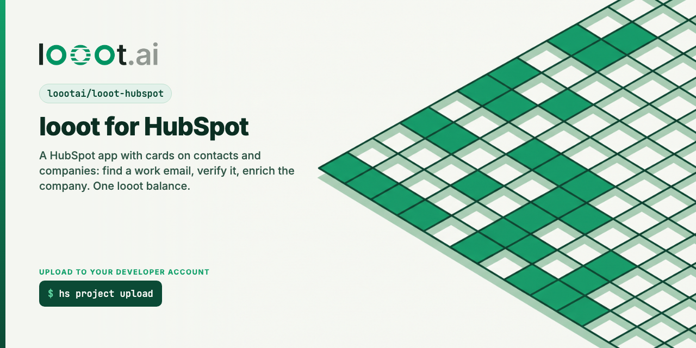

# looot for HubSpot

[](LICENSE) [](https://docs.looot.ai)

A [HubSpot](https://www.hubspot.com) public app for [looot](https://looot.ai). looot gives a workspace one key and
one prepaid balance for 4,200+ data endpoints from 300+ providers. This app uses three of its jobs to fill gaps
in contact and company records, from a card on the record or from a workflow.

Status: source only. Not installed on a live HubSpot account. It typechecks, lints and passes 81 unit tests, but it
has never been uploaded to HubSpot. See "Not tested on the live platform".

## What it adds to a HubSpot account

| What | Where in HubSpot | looot job | Price from (2026-10-09) |
|---|---|---|---|
| Find work email (card action) | Contact record, middle column | `people.email.find` | $0.003598 per lookup |
| Verify email (card action) | Contact record, middle column | `people.email.verify` | $0.00145 per lookup |
| Enrich company with looot (card action) | Company record, middle column | `company.enrich` | $0.0019 per lookup |
| Enrich with looot (workflow action) | Workflows on contacts and companies, lookup chosen in the action | any of the three | same as above |
| looot email status, looot industry, looot company size | three text properties the app creates | | |

Prices are the cheapest provider of each job in the public catalog
(`GET https://api.looot.ai/v1/catalog/overview?depth=jobs`) on 2026-10-09. They change. The card reads them live
from the backend, which reads that URL and caches it for five minutes. If the catalog is down it shows the same
three numbers with the date and says they are the last known price. The "from $X" figure is the catalog's cheapest
price per call. The real charge is `actualCost` on each run, shown in the card after the run.

### The cards

- Each action shows its price first and waits for a click on "Confirm and run". The backend also refuses any action
  call that does not carry `confirm: true`, so a stray request cannot spend money.
- **Find work email** reads the contact's first and last name, company, website and LinkedIn URL (and the associated
  company when the contact has none), then writes the email looot finds to the contact's `email`. A contact that
  already has an email is skipped before any call, so nothing is charged.
- **Verify email** checks the contact's email and writes the status to `looot_email_status`.
- **Enrich company with looot** sends the company's domain and name and writes `looot_industry` and
  `looot_company_size`. HubSpot's own Industry property only accepts a fixed list, so the app writes to its own
  properties instead.
- Every write fills empty fields only. A value that is already there is never overwritten. To run a new
  verification, clear `looot_email_status` first.
- The result shows the provider, the cost, the run id and exactly which properties were written or left alone.

### The workflow action

"Enrich with looot" has one input, `lookup` (find_work_email, verify_email or enrich_company), and these outputs:
`email`, `emailStatus`, `deliverable` (the text true or false), `industry`, `size`, `costUsd`, `provider`, `runId`
and `message`. It also writes empty fields on the record, like the cards. On a contact, `enrich_company` runs on the
contact's first associated company. If looot refuses or the run fails, the action answers `FAIL_CONTINUE` with the
reason in `message`, so the workflow keeps going.

### How a lookup is sent

Every lookup is `POST https://api.looot.ai/v1/runs` with `endpointId` set to `job:<job id>`, `wait: 25` and
`fallback: true` (or `{ enabled: true, maxCostUsd }` when `LOOOT_MAX_COST_USD` is set), so looot tries the next
provider of the same job when the first finds nothing and charges only the attempts that ran. The idempotency key is
`hubspot-` plus the SHA-256 of the job, the input and the UTC date: the same lookup twice in one day replays the
first run and pays once. Values come from looot's
[normalized output](https://docs.looot.ai/concepts/normalized-output). When the provider that answered has no field
map, the lookup counts as not found.

## Architecture

```
HubSpot record page          your backend (Node, src in backend/)            looot
  app card (React)  --hubspot.fetch, signed-->  /api/prices, /api/actions/*  --> api.looot.ai
  settings page     --hubspot.fetch, signed-->  /api/looot-token
  workflow          --signed webhook------->    /workflow/enrich
  install link      --OAuth redirect------->    /oauth/install, /oauth/callback --> api.hubapi.com
```

The HubSpot project (`hsproject.json`, `src/app/`) holds the app config, two cards, a settings page and the workflow
action. A public OAuth app cannot use HubSpot-hosted serverless functions: the developer platform feature table lists
serverless functions as available only for static-token private apps. So the cards call an external backend with
`hubspot.fetch()`, and the backend is the one place that stores each account's OAuth tokens and looot token. Docs:
https://developers.hubspot.com/docs/apps/developer-platform/overview and
https://developers.hubspot.com/docs/apps/developer-platform/add-features/ui-extensions/fetching-data

The backend uses `node:http` and the built-in `fetch`, with no runtime dependencies. Handlers take plain request data
and an injected `fetch`, clock and `TokenStore`, so every test runs without a network.

Backend routes:

| Route | Signed by HubSpot | What it does |
|---|---|---|
| `GET /oauth/install` | no | Redirects to HubSpot's consent screen with a signed `state` |
| `GET /oauth/callback` | no | Swaps the code for tokens at `POST https://api.hubspot.com/oauth/v3/token`, stores them per account, creates the three properties |
| `GET /api/prices` | yes | The three prices (live or dated fallback) and whether this account has a looot token |
| `POST /api/looot-token` | yes | Checks the token with `GET /v1/balance`, then saves it. Never returns it |
| `POST /api/actions/find-work-email`, `verify-email`, `enrich-company` | yes | Reads the record, runs the looot job, writes empty fields, returns a summary |
| `POST /workflow/enrich` | yes | The workflow action endpoint |
| `GET /health` | no | Liveness |

Every signed route checks `X-HubSpot-Signature-v3` (HMAC SHA-256 of method, URL, raw body and timestamp, base64) and
rejects a timestamp more than five minutes off. The URL is rebuilt from `PUBLIC_BASE_URL`, so set it to the exact
https origin HubSpot calls.

Token storage: `MemoryTokenStore` (tests) and `JsonFileTokenStore` (local use, a plain-text JSON file with mode 0600).
Production needs a `TokenStore` that encrypts OAuth tokens and looot tokens at rest. Tokens are never logged and the
looot token is never sent back to the browser.

## Scopes requested

| Scope | Kind | Why |
|---|---|---|
| `crm.objects.contacts.read` | required | Read name, company, website, LinkedIn URL and email of a contact |
| `crm.objects.contacts.write` | required | Write the found email and the verification status |
| `crm.objects.companies.read` | required | Read domain and name of a company, and the company of a contact |
| `crm.objects.companies.write` | required | Write industry and size |
| `crm.schemas.contacts.write` | optional | Create the `looot_email_status` property on install |
| `crm.schemas.companies.write` | optional | Create `looot_industry` and `looot_company_size` on install |

No sensitive data scopes. The docs say an app with those cannot use `hubspot.fetch()`. Without the two optional scopes
the lookups still run, but the properties do not exist, so the app reports "not written" for them instead of failing.
The workflow action needs no extra scope in the project config. (The legacy API listed an `automation` scope for
custom actions. Not verified whether the 2026.09 project framework wants it; see the checklist below.)

## Settings

| Variable | Required | What it is |
|---|---|---|
| `HUBSPOT_CLIENT_ID`, `HUBSPOT_CLIENT_SECRET` | yes, secret | From the app's Auth page in HubSpot |
| `HUBSPOT_REDIRECT_URI` | yes | One of `redirectUrls` in `src/app/app-hsmeta.json`, for example `https://YOUR-BACKEND.example.com/oauth/callback` |
| `PUBLIC_BASE_URL` | yes | The public https origin of the backend |
| `LOOOT_MAX_COST_USD` | no | The most one lookup may spend across the providers looot tries, for example `0.05` |
| `TOKEN_FILE` | no | Path of the JSON token file, default `.hubspot-tokens.json` |
| `HUBSPOT_ALLOW_SIGNATURE_V2` | no | `true` also accepts the older v2 signature. Off by default because v2 has no timestamp |

The looot agent token is not an environment variable. Each HubSpot account pastes its own in the app's Settings page.
Create it in the looot dashboard under Settings, Agent tokens, with `catalog.read`, `runs.read`, `runs.execute` and
`usage.read`.

## Develop and test

Needs Node 20.19 or newer (`.nvmrc` pins 24.5.0).

```bash
npm ci --ignore-scripts
npm run typecheck     # backend + tests, then the card and settings code
npm run lint
npm test              # 81 tests, looot and HubSpot replaced by stand-ins
npm run build         # compiles the backend to dist/
```

Output on 2026-10-09, Node 24.18.0:

```
 Test Files  7 passed (7)
      Tests  81 passed (81)             (npm test)
typecheck: 0 errors                     (npm run typecheck: tsc --noEmit on both tsconfigs)
lint: 0 errors                          (npm run lint: eslint 9, typescript-eslint)
build ok                                (npm run build)
leak-scan: clean                        (bash scripts/leak-scan.sh .)
```

No test calls looot or HubSpot, so no test spends credit. The tests include:

- the request signature against the v3 and v2 vectors printed in HubSpot's own docs, a tampered body and a stale timestamp;
- the OAuth code exchange (form body, `hub_id` as the account id), the refresh, and the retry after a 401;
- each action: the exact looot body, empty-field-only writes, 401, 402 and failed-run messages, missing normalized
  fields as "not found", and the refusal to run without `confirm: true`;
- prices with the catalog down, the workflow output shape, and the idempotency key rule;
- a static test that loads every `*-hsmeta.json` and checks uid, type, required fields, entrypoints, scopes against
  the backend, the placeholder host, and that the pins in the three package.json files agree.

Local run: copy `.env.example` to `.env`, fill it in, export the variables, `npm run build && npm start`. HubSpot
needs an https backend URL, so use a tunnel or a host. See the proxy notes in the fetching-data doc for local
development.

## Ship it unlisted first

These steps need a HubSpot account, so a person does them. None of them were run.

1. Create a HubSpot developer account at developers.hubspot.com and, in it, a developer test account.
2. Install the CLI pinned: `npm install --global @hubspot/cli@8.15.0`, then `hs account auth` and choose the developer account.
3. Deploy the backend to any Node 20.19+ host with https. Set the environment variables above. Replace the
   in-memory or JSON file store with an encrypted one before real customers use it.
4. Replace `https://YOUR-BACKEND.example.com` with the real origin in all of these places, then run `npm test`
   (the static test fails if they disagree): `src/app/app-hsmeta.json` (`redirectUrls`, `permittedUrls.fetch`),
   `src/app/workflow-actions/enrich-with-looot-hsmeta.json` (`actionUrl`), `src/app/cards/backend.ts` and
   `src/app/settings/Settings.tsx`. Update the placeholder in the test too.
5. In `src/app/cards` and `src/app/settings` run `hs project install-deps`, then from the repo root
   `hs project validate` and `hs project upload`.
6. In HubSpot, open the project (`hs project open`), click the app, copy the client ID and secret from the Auth
   tab, and put them in the backend environment.
7. Distribution tab, "Begin publishing", sign the Acceptable Use Policy. Until it is signed the app installs only in
   developer test accounts. The tab then shows a sample install URL. Both that URL and `GET /oauth/install` on the
   backend work: the callback accepts an install with no `state` and rejects a `state` it did not issue.
8. Install it in the developer test account. HubSpot shows an "unverified app" warning; type the confirmation text it asks for.
9. In the test account: Marketplace, Connected apps, looot, Settings, paste a looot agent token. Open a contact,
   Customize the middle column, add the looot card from the Card library. Do the same on a company.
10. In Workflows, add the action "Enrich with looot". The workflow action ships with `isPublished: false`; set it to
    `true` and upload again when the action should be visible in accounts that install the app.
11. Send the install URL to three outside accounts (not your own organization). Each needs a Super Admin or a user
    with Marketplace access to install.

An unlisted marketplace-distribution OAuth app can be installed in up to 25 accounts, not counting developer test
accounts. Source: https://developers.hubspot.com/docs/apps/developer-platform/build-apps/manage-apps-in-hubspot

### Marketplace listing requirements (quoted from the page read on 2026-10-09)

Source: https://developers.hubspot.com/docs/apps/developer-platform/list-apps/listing-your-app/app-marketplace-listing-requirements

- "Installs: your app must have at least three active, unique installs."
- "Active installs are the number of unique HubSpot production accounts, unaffiliated with your organization, showing
  successful app activity within the past 30 days."
- "App activity is defined by OAuth-authenticated requests to HubSpot's APIs and signed requests from HubSpot webhook
  subscriptions and extensions (e.g. app card data fetch requests)."
- "OAuth: your app must use OAuth as its sole authorization method."
- "Scopes: only request scopes your app needs." The same page says unused scopes must be removed.
- "Single HubSpot app ID", "Uniqueness", and "Use case" rules, the Technology Partner Program Agreement, restricted
  industries, and no classic CRM cards.
- App cards: no HubSpot names in the card name, no sensitive data scopes, forms need submit buttons, one primary
  button per surface, and the cards go through a separate review by the HubSpot Ecosystem Quality team.
- A listing needs specific content, live public URLs, a public setup guide, an Install button URL, support, terms and
  privacy URLs, accurate shared data and pricing, and a support contact method.
- Review: "an initial review within 10 business days", and the whole process "no more than 60 days from the time
  feedback is shared".

Do not call the app "HubSpot looot" or similar: the page forbids combining HubSpot's name with an app name. The app
is named "looot". The listing and the app card review form are submitted by hand in HubSpot. This repo does not submit anything.

## Docs read

All read on 2026-10-09. Platform version found: 2026.09 (marked "Current"; 2026.03 and 2025.2 are "Supported").
`hsproject.json` pins `2026.09`.

- https://developers.hubspot.com/docs and https://developers.hubspot.com/docs/llms.txt (index)
- https://developers.hubspot.com/docs/apps/developer-platform/overview (feature table: app cards, settings and custom workflow actions are available for OAuth marketplace apps; serverless functions only for static-token private apps)
- https://developers.hubspot.com/docs/developer-tooling/platform/versioning (platform versions, `hsproject.json` example)
- https://developers.hubspot.com/docs/apps/developer-platform/build-apps/app-configuration (`app-hsmeta.json`, `permittedUrls`, scopes, distribution)
- https://developers.hubspot.com/docs/apps/developer-platform/build-apps/create-an-app
- https://developers.hubspot.com/docs/apps/developer-platform/build-apps/manage-apps-in-hubspot (install limits, unlisted install, unverified app dialog)
- https://developers.hubspot.com/docs/apps/developer-platform/add-features/ui-extensions/extension-points/app-cards/overview
- https://developers.hubspot.com/docs/apps/developer-platform/add-features/ui-extensions/extension-points/app-cards/create-an-app-card
- https://developers.hubspot.com/docs/apps/developer-platform/add-features/ui-extensions/extension-points/app-cards/reference (card config, `objectTypes`, locations)
- https://developers.hubspot.com/docs/apps/developer-platform/add-features/ui-extensions/extension-points/create-a-settings-page
- https://developers.hubspot.com/docs/apps/developer-platform/add-features/ui-extensions/fetching-data (`hubspot.fetch()`, `permittedUrls.fetch`, limits)
- https://developers.hubspot.com/docs/apps/developer-platform/add-features/custom-workflow-actions (project config)
- https://developers.hubspot.com/docs/api-reference/latest/automation/workflow-actions/custom-action-reference (execution payload, `outputFields`, `hs_execution_state`)
- https://developers.hubspot.com/docs/api-reference/latest/automation/workflow-actions/custom-action-guide
- https://developers.hubspot.com/docs/apps/developer-platform/build-apps/authentication/request-validation (v3 and v2 signatures)
- https://developers.hubspot.com/docs/apps/developer-platform/build-apps/authentication/oauth/working-with-oauth (authorize URL, query parameters)
- https://developers.hubspot.com/docs/api-reference/legacy/authentication/manage-oauth-tokens (`POST /oauth/v3/token`)
- https://developers.hubspot.com/docs/apps/developer-platform/build-apps/authentication/scopes
- https://developers.hubspot.com/docs/apps/developer-platform/build-apps/authentication/overview
- https://developers.hubspot.com/docs/api-reference/latest/crm/objects/contacts/guide (`/crm/objects/2026-09/contacts/{id}`)
- https://developers.hubspot.com/docs/api-reference/latest/crm/properties/guide (`POST /crm/properties/2026-09/{objectType}`)
- https://developers.hubspot.com/docs/developer-tooling/local-development/hubspot-cli/project-commands (`hs project validate`)
- https://developers.hubspot.com/docs/apps/developer-platform/list-apps/listing-your-app/app-marketplace-listing-requirements

Where the docs differ from what the task brief assumed:

- The token endpoint is `POST https://api.hubspot.com/oauth/v3/token` with a form body, not the older `/oauth/v1/token`.
- The CRM API is date versioned (`/crm/objects/2026-09/...`), not `/crm/v3/...`.
- The allow-list key in the app config is `permittedUrls.fetch`.
- The settings page exists for OAuth marketplace apps, so the looot token form lives there, not in the card.
- The docs for app cards still say "versions 2025.2 and 2026.03", while the versioning page lists 2026.09 as current.
  The project uses 2026.09 and the card config shape from the card reference.

## Not tested on the live platform

Never run: an upload to any HubSpot account, a card render, an OAuth exchange against HubSpot, a workflow action
execution, a real `hubspot.fetch()` call, a real looot run.

`hs project validate`: not run to completion. `@hubspot/cli` 8.15.0 was installed to try it, answered "Config file not
found, run hs account auth to configure your account", and no account was authenticated. It is not a dependency of
this repo; install it as in the ship steps. Run `hs project validate` first.

What to check first, in order:

1. `hs project validate` and `hs project upload` accept the project. The most likely complaints: the placeholder
   host, the `inputFieldOptionLabels` shape in the workflow action (copied from the guide's example), `outputFields`
   typed as `string`/`number`, and whether the workflow action also needs the `automation` scope.
2. The install: consent screen shows the four required and two optional scopes, and the callback stores tokens and
   creates the three properties (check Properties in Settings).
3. The signature. The docs say card data fetches arrive with `X-HubSpot-Signature-v3`, but the v2 section of the same
   page says app card requests carry `X-HubSpot-Signature-Version: v2`. Not verified which header a card fetch sends.
   If requests come back 401 with `missing_signature`, set `HUBSPOT_ALLOW_SIGNATURE_V2=true`. The backend signs over
   the raw body text and the URL built from `PUBLIC_BASE_URL`; the docs' sample uses `JSON.stringify(body)`.
4. A card on a contact: prices load, Confirm runs, and the email lands on a contact that had none.
5. The `hubspot.fetch()` body: the card sends `body: { objectId, confirm }` as an object and the backend reads it as
   JSON. Not verified how HubSpot serializes it.
6. The associations call `GET /crm/objects/2026-09/contacts/{id}/associations/companies` and its response shape
   (`results[].toObjectId`). It is assumed from the legacy shape, not read in the docs.
7. The workflow action: it appears, `object.objectId` and `origin.portalId` arrive as the docs show, and the outputs
   map into a later step. `objectRequestOptions` is not used; the backend reads the record itself.
8. The UI extension components: `Alert`, `Button`, `Input`, `Flex`, `Text` come from `@hubspot/ui-extensions` 0.17.0 and
   typecheck, but were never rendered.
9. One real lookup of each kind with your own looot token.

## Related

- [looot-attio](https://github.com/loootai/looot-attio) and [twenty-app-looot](https://github.com/loootai/twenty-app-looot): the same three lookups on other CRMs.
- [looot-instantly](https://github.com/loootai/looot-instantly): find and verify work emails, then load them into an Instantly campaign.
- [looot-zapier](https://github.com/loootai/looot-zapier), [looot-make](https://github.com/loootai/looot-make), [n8n-nodes-looot](https://github.com/loootai/n8n-nodes-looot): looot on automation tools.
- [looot-mcp](https://github.com/loootai/looot-mcp): the remote MCP server, `claude mcp add --transport http looot https://api.looot.ai/mcp`.
- [awesome-gtm](https://github.com/loootai/awesome-gtm): open-source GTM tools.

MIT, copyright looot.
